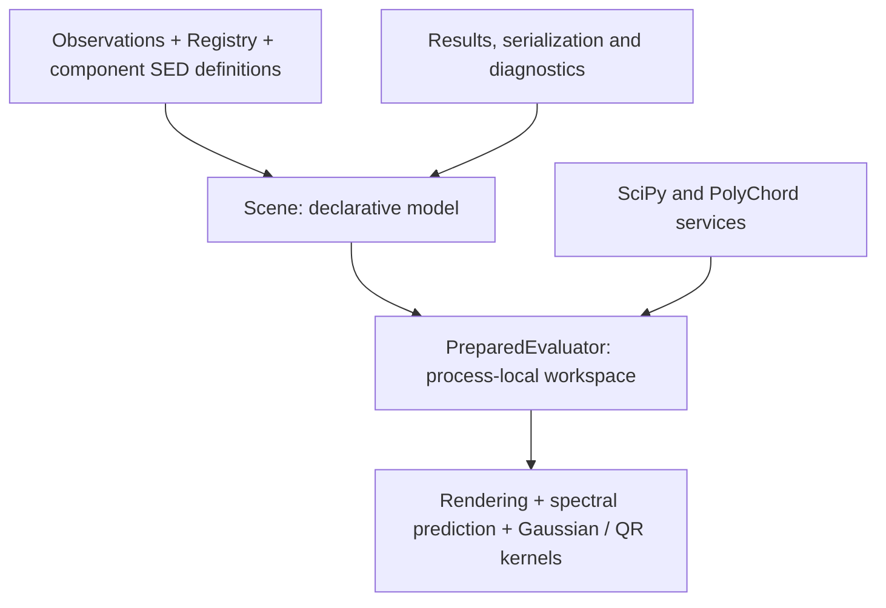

# CPU-first architecture and migration

The scientific model, parameter names, units and priors remain unchanged.
Refactoring starts from commit d67018c with an independently saved reference
evaluation and bounded baseline benchmarks. No target discovery belongs here.

| Previous responsibility | Refactored owner |
|---|---|
| Scene scientific assembly and parameter relationships | Scene and Registry |
| Scene caches, renderer and spectral state | PreparedEvaluator in execution.py |
| Scene fitting loops | optimize.py services, thin Scene.fit convenience |
| Nuclear Gaussian integral in PolyChord module | gaussian.py, sampler-independent |
| Full component and compressed reference algorithms | direct.py and likelihood.py, using the same evaluator |
| Output and plots | result.py / plotting.py, outside evaluation |

The previous direct-to-PolyChord mathematical dependency is removed.
Scene.prepare() provides explicit execution ownership. Existing Scene.predict,
residual, fit and sampling conveniences delegate to the relevant owner.
Private cache attributes temporarily expose the same workspace for older
internal callers; they never create a duplicate cache or physical model.
Serialized scene definitions omit the evaluator and its live resources.

Subsequent tested stages add compiled parameter layouts, reusable noise
preparation, aggregate rendering, lazy workload policy, profiled derivatives,
image-domain SED gates and stored nuclear conditional reconstruction.
Experimental differentiable backends remain gated and are not expanded here.
