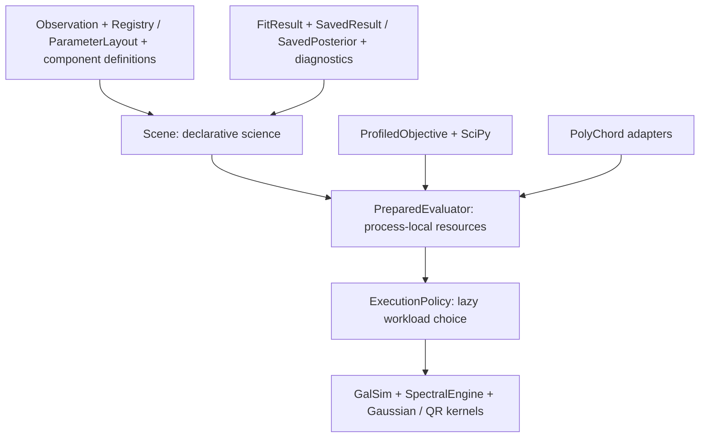

# CPU-first architecture and migration

The physical model, parameter names, priors, zero-based reference coordinates,
semimajor radii, reference +x position angles and total microJy fluxes are
unchanged. Cropped profiles retain aperture losses. The saved pre-refactor
synthetic images and component arrays remain bitwise identical.



| Previous responsibility | Authoritative owner |
|---|---|
| Scene model choices / relationships | scene.py and parameters.py |
| Parameter ordering, roots, ties and dependency groups | layout.py; Registry.layout |
| Scene mutable caches and prepared noise | execution.py; PreparedEvaluator |
| Auto likelihood switching | policy.py; one ExecutionPolicy |
| Empirical PSFs / component and summed extended rendering | rendering.py; GalSimRenderer |
| Stellar process state and independent unit flux queries | spectral.py; SpectralEngine |
| Shared immutable stellar libraries / accuracy gates | templates.py |
| Gaussian data / normalized kernels / nuclear integral | gaussian.py, no sampler dependency |
| Independent full reference / stable sufficient statistics | direct.py / likelihood.py |
| Global bounded linear amplitudes | linear.py; LinearProjection |
| ML/MAP profiling and dependency-aware finite differences | objectives.py |
| Deterministic optimization / derivative resources | optimize.py / workers.py |
| PolyChord, derived conditional columns and posterior restoration | inference.py |
| Stable content signatures / schema versions | provenance.py |
| Resource-free reading and migration | records.py |
| Images, tables, spectra, plots and reports | result.py / plotting.py |

Scene is a convenient declarative facade. prepare() lazily creates its one
workspace; fit(), sample(), predict() and residual() delegate. Scene pickling
omits live workspaces, pools and FSPS state. Each worker owns its evaluator and
shutdown. Normal scene evaluation prepares independent FSPS states without
starting processes on the component definitions; immutable tables may be
shared. Reference synthesis remains lazy for table fallback.

There is one fitting implementation and one parameter layout. parallel.py and
AutoGaussianLikelihood are thin compatibility re-exports. Existing private
cache accessors temporarily resolve the same workspace, not duplicate engines.
The independently callable full pixel reference is intentionally retained.

## Execution requests

FullPixelLikelihood(...).evaluate(values, linear=...) returns the normalized
Gaussian score and requested nuclear conditional parameters. It can render
components or the total extended light without building QR statistics.
PreparedEvaluator also supplies component columns, full residuals and explicit
compressed evaluation. Optional spectra and component diagnostic images are
constructed only when requested.

The default policy reuses unchanged component columns and fixed-image residual
anchors. Compression is lazy, with no automatic build threshold. Explicit
compressed requests, variable projection, or a measured compression_after
threshold can amortize QR setup. Aggregate rendering remains opt-in. Execution
history changes cost, not statistical semantics.

## Migration and reproducibility

Legacy YAML without schema_version remains schema 1, with unchanged meaning.
New execution choices require schema 2:

```yaml
schema_version: 2
execution:
  rendering: components  # aggregate is an explicit validated alternative
  compression_after: null
fitting:
  optimizer: scipy
  method: trf
  jacobian: dependency   # scipy keeps independent finite-difference fallback
  workers: 1
  max_wall_seconds: 60   # soft budget checked between evaluations
```

Initial values, numerical bounds and normalized statistical priors remain
separate. MAP density is defined in registered coordinates; log_mass is log10
formed mass. Refactoring adds no amplitude prior or coordinate Jacobian.
TRF always receives complete profiled pixel residuals; every perturbation
re-solves all eligible amplitudes. Nonquadratic priors prevent plain linear
projection. ML explicitly omits statistical priors, retaining numerical bounds.

Use Observation.update(data=..., sigma=..., mask=..., covariance=...) after
preparation; fixed arrays are read-only. Data-only updates reuse fixed noise.
Resource ownership supports with Scene(...) and explicit close(). A script
starting spawned stellar/derivative processes needs a normal __main__ guard.

SavedResult.read accepts result schemas 1 and 2. New outputs record schema 2,
ordered definitions and stable model/input signatures. SavedPosterior.read
separates sampled and derived columns. Legacy posterior restoration requires
explicit allow_legacy_replay=True with matching original model and inputs.
Incompatible checkpoint signatures/order/schema are rejected; use a new run
directory. Signatures include input contents, priors, physical configuration,
rendering settings and dependency versions, not initial guesses or addresses.
Opaque custom covariance operators require a stable persisted signature.


Posterior sampling adds sampler-independent posterior.py and transactions.py.
blocked.py and population.py are optional experimental inference adapters over
that same target; basic Gaussian mathematics does not depend on them. See
[SAMPLING_EFFICIENCY.md](SAMPLING_EFFICIENCY.md) for ownership and gate details.
